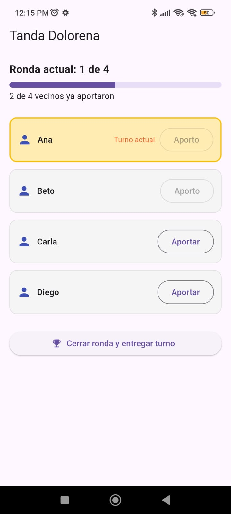
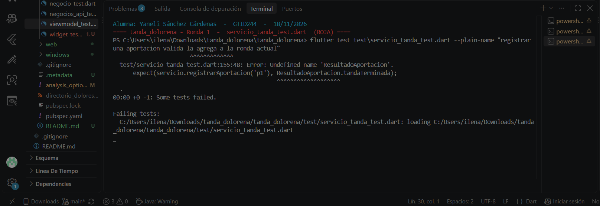
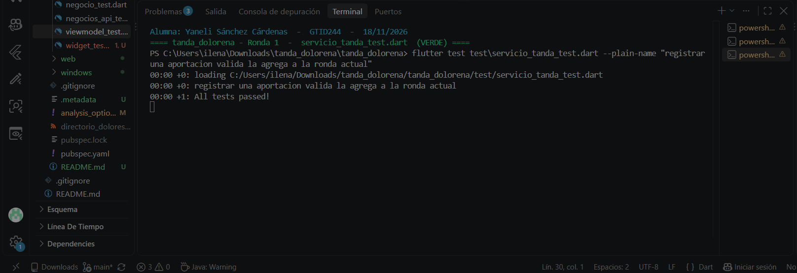
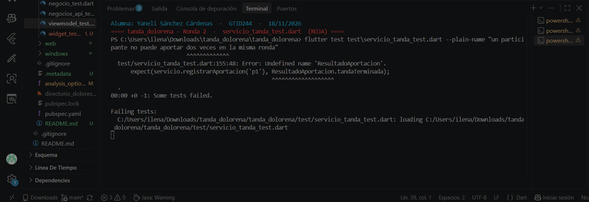
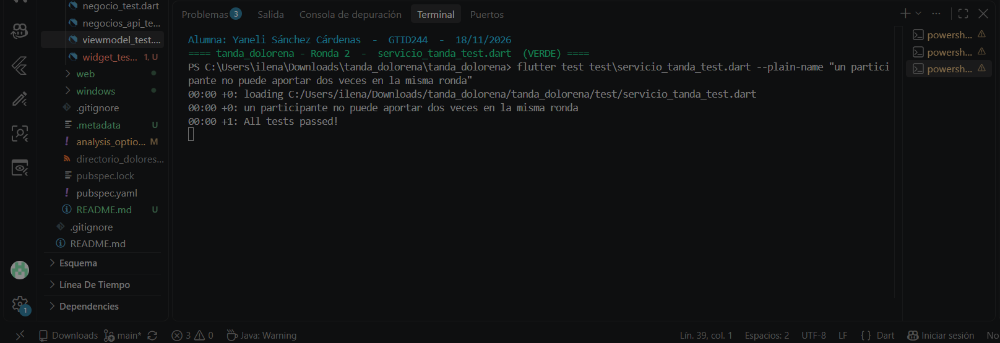
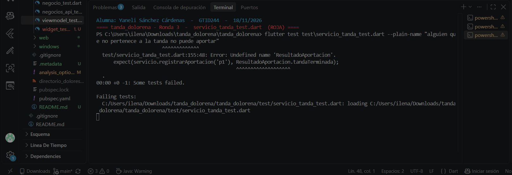
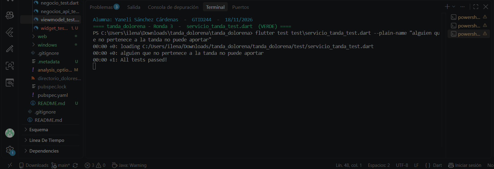
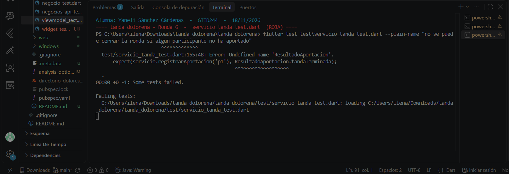
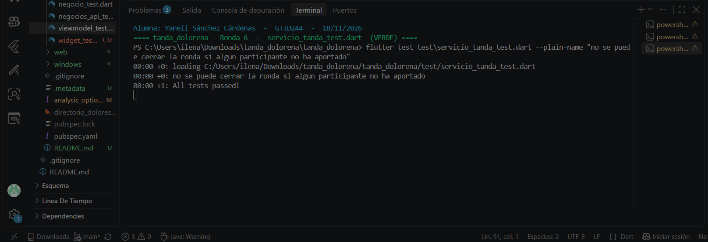

# Tanda Doloreña

Sistema de ahorro rotativo vecinal, hecho con TDD (Desarrollo Móvil Integral, UTNG). Toda la lógica está en `lib/logica` (Dart puro) y la pantalla animada solo la usa.

## Cómo abrirlo y correrlo en Visual Studio Code

1. Descomprime la carpeta `tanda_dolorena` y ábrela con **File > Open Folder**.
2. Abre la terminal de VS Code (Ctrl + ñ) y ejecuta **una sola vez**, dentro de la carpeta:

   ```
   flutter create .
   flutter pub get
   ```

   `flutter create .` solo agrega las carpetas de plataforma (android, ios, windows, web...). No toca `lib/`, `test/` ni `pubspec.yaml`.
3. Pruebas: `flutter test` (debe terminar con "All tests passed!", 12 pruebas).
4. Ejecutar la app: `flutter run` (elige dispositivo abajo a la derecha en VS Code).

Nota: se agregó una prueba extra (cerrar ronda cuando la tanda ya terminó) y la pantalla ya no falla al terminar la tanda; el manual no lo cubría.

## Estructura

```
lib/
  modelos/        participante.dart, tanda.dart, cierre_ronda.dart
  logica/         resultado_aportacion.dart, resultado_cierre.dart, servicio_tanda.dart
  presentation/   tanda_screen.dart
  main.dart
test/
  servicio_tanda_test.dart
```

## La app funcionando en el celular



---

## Evidencias TDD (rojo → verde)

**Alumna:** Yaneli Sánchez Cárdenas · **Grupo:** GTID244

Cada ronda muestra primero la prueba en **rojo** (falla porque el código aún no existe) y después en **verde** (pasa con la implementación). En cada captura se ve la prueba que se ejecuta, el resultado en la terminal, mi nombre y mi foto de perfil.

### Ronda 1

**🔴 Rojo — la prueba falla**



**🟢 Verde — la prueba pasa**



### Ronda 2

**🔴 Rojo — la prueba falla**



**🟢 Verde — la prueba pasa**



### Ronda 3

**🔴 Rojo — la prueba falla**



**🟢 Verde — la prueba pasa**



### Ronda 4

**🔴 Rojo — la prueba falla**


**🟢 Verde — la prueba pasa**


### Ronda 5

**🔴 Rojo — la prueba falla**


**🟢 Verde — la prueba pasa**


### Ronda 6

**🔴 Rojo — la prueba falla**



**🟢 Verde — la prueba pasa**


